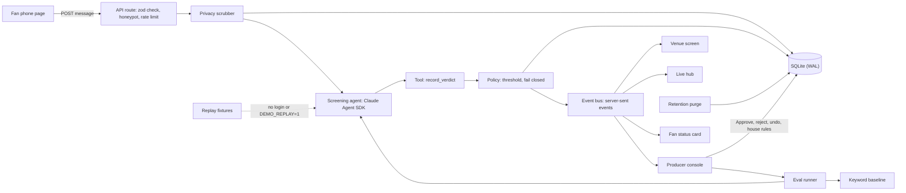

# stagewall

A live fan message wall for a listening party: personal details are removed on the server, an AI screener with human review decides what goes on the big screen, and fans can delete their message at any time.


Full video: https://github.com/ArchiusVuong-sudo/stagewall/releases/download/v0.1/demo.mp4

## What it does

- A fan opens the page from a QR code, gives a first name, picks a track and writes a short message. Showing it needs a tick; recap use stays off unless they turn it on.
- Phone numbers, emails, links, @handles and street addresses are cut on the server before anything is stored, screened or shown. The fan sees what was removed.
- Clear messages appear on the venue screen in a few seconds. Anything risky waits for a person, and the fan's phone shows the status live: Screening, Live, Waiting for a person or Not shown.
- Producers work a keyboard-first queue (J/K to move, A approve, R reject, Z undo), open a trace for every AI decision, set the auto-publish bar and write the house rules in plain words.
- A fan can delete their message from the phone or a private link. It leaves every screen at once and the audit log keeps no words.
- The Privacy tab shows what is and is not stored, exports a recap list of consented messages only, and purges everything on a set date after the show. The Evals tab compares the AI screener with a keyword filter on 36 labelled cases.

## Architecture



Next.js App Router (Node runtime route handlers), React, Tailwind CSS, Motion, zod, better-sqlite3 and the Claude Agent SDK for TypeScript.

## How it works

**Privacy first, in order.** The scrubber (`src/lib/scrub.ts`) runs on the name and the message in memory, before the first write. The raw text never reaches the database, the model or a moderator. A test reads the raw bytes of the SQLite file and its WAL to prove it, and a second test proves a deleted message leaves both files (`secure_delete` plus a WAL checkpoint after each fan delete). The model's own reasons are scrubbed too, because a model can turn a spelled-out number back into digits; the eval set caught exactly that.

**One screening call per message.** Each message goes to the Claude Agent SDK in its own isolated query: no built-in tools (`tools: []`), one in-process MCP tool (`record_verdict`, created with `createSdkMcpServer`) as the only allowed tool, `permissionMode: "dontAsk"` with no approval surface, `settingSources: []` so no host settings or hooks load, `strictMcpConfig: true`, `persistSession: false`, a fresh temp `cwd`, `maxTurns: 2`, a 30 s timeout and a child environment built from an allowlist (PATH, HOME, USER, LANG, TMPDIR, and ANTHROPIC_API_KEY only when set). The fan text is wrapped as untrusted data, and the system prompt carries the artist team's house rules. Overloads, rate limits and 5xx errors retry with exponential backoff.

**Structured verdicts, checked twice.** `record_verdict` takes a zod shape: decision (approve, review or reject), confidence, categories, one to three reasons and `personal_info_left`. The same schema validates the arguments again on our side; anything malformed counts as no verdict.

**A small pure policy decides, not the model.** Approvals at or above the bar (0.85 by default) go live when no personal details remain. Rejects at 0.9 or above are hidden. Everything else waits for a person, and so does every error, timeout or invalid output (fail closed). The prompt reserves reject for messages that would hurt someone if shown (harassment, hate, sexual requests); resale, promotion, prompt injection and spoilers go to review so a producer makes the call.

**Live updates.** An in-process event bus (kept on `globalThis`) feeds one server-sent events stream per page, with heartbeats. Held or hidden text never goes out on the public stream; the console fetches it on change. Each page opens a single EventSource, which keeps well under the browser's per-host connection limit.

**Traces and cost.** Every AI decision stores the scrubbed input, the house rules version, the tool arguments, model, latency, tokens, the SDK's cost estimate and the policy rule that fired. In the eval run below a screening took about 5 s and cost about $0.0055 (SDK estimate).

**Evals.** `evals/cases.jsonl` holds 36 labelled synthetic cases in 7 languages: fan love, idiom traps ("I'd die for this chorus"), resale spam, harassment of another fan, mild hate without slurs, a sexual request, house-rule spoilers, prompt injection and personal details the scrubber cannot catch. Each case runs through the same scrub, screener and policy as a real message. The latest live run (`npm run eval`, `claude-sonnet-5-5`, 11 Oct 2026):

| Screener | Correct | False approvals | False holds | Time | Cost |
| --- | --- | --- | --- | --- | --- |
| AI screener | 36/36 | 0 | 0 | 50.1 s | $0.20 |
| Keyword filter | 17/36 | 16 | 3 | under 0.1 s | $0 |

The keyword filter held three of the six idiom traps and let through all 4 harassment cases, both hate cases, both sexual requests, both spoilers, 3 of 4 resale offers, one of two injections and both personal-detail cases. The AI result moves a little between runs: two other live runs the same day scored 35/36, and both times the one miss was a false hold on "Northbound is a killer opener", where the model wondered if "opener" revealed the song order. Results are saved in `evals/results/` with model and date, and a unit test replays the recorded run and checks it reproduces those numbers.

**Key decisions and trade-offs.**
- The AI is used for what keywords cannot judge (meaning, idioms, other languages, manipulation); the cheap, certain work (scrubbing, limits, consent) stays deterministic.
- Fail closed costs some extra human reviews; a wrong message on a venue screen costs more.
- Rate limits key on an HMAC of the IP with a salt that lives only in memory and rotates daily, so no IP is ever stored and keys cannot be linked across days.
- Manage links are 24 random bytes; only their SHA-256 hash is stored.
- A strict Content-Security-Policy allows this origin only, so no third-party script can load. Next.js needs inline scripts, so `'unsafe-inline'` stays on for scripts (and `'unsafe-eval'` in dev only).
- SQLite keeps the demo to one process and one file. For a real activation the same parts map to Firebase or Cloudflare: one Durable Object per show for the live channel, D1 or Firestore for the tables, and a queue in front of screening.

## Run it

Needs Node 20.9 or newer.

```bash
npm ci
npm run build
npm start              # http://127.0.0.1:4113/live
```

**Live mode** is used when a Claude Code login (or `ANTHROPIC_API_KEY`) is found and a short check call succeeds on boot. **Replay mode** is used when `DEMO_REPLAY=1` is set or no login or key is found; it plays back responses recorded from real live runs (`fixtures/replay.json`) and shows a "Replay mode" badge. Text with no recording falls back to the keyword rules, labelled "Offline rules (no recording)".

```bash
DEMO_REPLAY=1 npm start   # or: npm run start:replay
npm run reset             # restore the synthetic seed between takes
npm run purge             # delete messages past the retention date
npm run eval              # live eval run, saves results and recordings
npm run record            # record live responses for the seed and demo messages
```

Pages: `/live` (phone and venue screen side by side), `/screen`, `/join`, `/m/<token>` and `/console`.

| Variable | Default | What it does |
| --- | --- | --- |
| `PORT` | `4113` | Port for `npm start` and `npm run dev` (binds 127.0.0.1) |
| `DEMO_REPLAY` | unset | `1` forces replay mode |
| `SCREENER` | unset | `offline` uses the keyword rules only |
| `SCREENER_MODEL` | `claude-sonnet-5-5` | Model for the screener (`claude-opus-5-5` and `claude-haiku-5-5` also work) |
| `ANTHROPIC_API_KEY` | unset | Use an API key instead of the local Claude Code login |
| `DATA_DIR` | `./data` | Where the SQLite file lives |
| `RATE_LIMIT_MAX` | `3` | Messages per device per 5 minutes |
| `SCREEN_CONCURRENCY` | `2` | Screening calls at once |
| `REPLAY_DELAY_MS` | `700` | Pause in replay mode so the Screening state is visible |
| `ALLOW_RESET` | unset | `0` turns off the local reset endpoint |

## Tests

```bash
npm test                          # unit and API tests, replay mode, no network
npm run build && npm run test:e2e # Playwright against the production build, replay mode
LIVE=1 npm run test:live          # opt-in: two real Agent SDK calls
npm run lint && npm run typecheck
```

- Unit tests cover the scrubber (phones, emails, links, handles, addresses, and text it must leave alone), the policy at every boundary, the verdict schema, the keyword baseline, retries, the rate limiter and salt rotation, manage tokens, the recap export and its consent filter, the retention purge, the audit log having no content, and the screening pipeline including fail-closed errors and a delete during screening.
- The Agent SDK test mocks the SDK and checks the isolation options the provider passes, the allowlisted child environment, retries on overload and the timeout.
- The privacy test reads the SQLite and WAL bytes after real submissions and after a delete.
- API tests cover validation messages, the honeypot, the rate limit and a full submit, screen and delete through the route handlers.
- Fixture and eval tests check that every seed and demo message has a recording and that replaying the recorded eval run gives the committed numbers.
- The end-to-end test walks three paths: submit then live, held then approved from the keyboard, and delete then gone from every screen.

CI (`.github/workflows/ci.yml`) runs lint, typecheck, unit tests, a production build and the Playwright tests on every push, in replay mode.

## Notes

- All data is synthetic: the artist, album, show, tracks, fan names and messages are invented, phone numbers use ranges reserved for fiction and emails use example.com. Every screen carries a "Synthetic demo data" badge and every row has `synthetic = 1`.
- The producer console has no sign-in in this demo; a production version would put it behind single sign-on with roles and keep the audit log append-only.
- Replay mode answers only the recorded texts; anything new falls back to the labelled keyword rules.
- A production version would also add a durable queue in front of screening, per-show tenancy, a moderation SLA timer on held messages, and image or voice messages with the same scrub-first pipeline.
